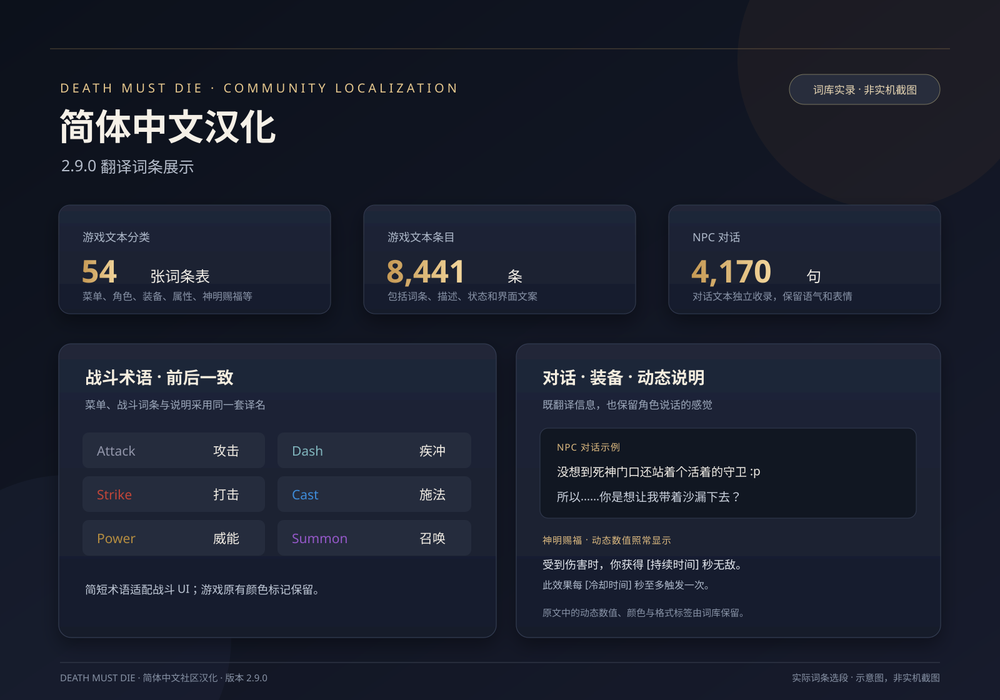

# Death Must Die 简体中文汉化

为《Death Must Die》制作的非官方简体中文汉化，当前版本 **2.9.0**。游戏没有简体中文选项，本项目通过 BepInEx 插件提供中文文本与字体。



图中选段来自实际汉化词库。数值位置用方括号作说明；此图是词条展示图，不是游戏实机截图。

## 翻译亮点

- **覆盖战斗、装备和成长内容。** 词库包含 54 张文本表、8,441 条游戏文本，涵盖菜单、角色、技能、神明赐福、装备词缀、状态说明、神龛和成就等内容。
- **术语前后一致。** 例如 Attack 译为“攻击”、Dash 译为“疾冲”、Strike 译为“打击”、Cast 译为“施法”、Power 译为“威能”、Summon 译为“召唤”。原有颜色标记一并保留，方便在战斗中辨认类型。
- **单独整理 NPC 对话。** 收录 4,170 句对话，并保留原文中的语气、停顿和表情，例如：“没想到死神门口还站着个活着的守卫 :p”。
- **保留动态文本格式。** 伤害、持续时间等数值仍由游戏动态填入；颜色和富文本格式标签沿用游戏模板。
- **呈现角色与物品风格。** 角色、唯一物品、前后缀、词缀效果、神龛和成就各自使用对应名称与描述，例如骑士 Avoron 译为“阿沃伦”，Sorceress Merris 译为“梅莉丝”。

## 下载与安装

前往 [Releases](https://github.com/WeiDengHong/DeathMustDie-Chinese/releases/latest)，下载 `DeathMustDie-Chinese-2.9.0-Terminal.zip`。请勿下载 GitHub 自动生成的 “Source code” 压缩包。

1. 完整解压安装包。
2. 退出游戏，双击 `Install.cmd`。
3. 安装程序会查找 Steam 游戏目录；找不到时，输入包含 `Death Must Die.exe` 的文件夹路径。
4. 显示安装成功后，从 Steam 正常启动游戏。

也可以在解压目录打开 PowerShell 并指定游戏路径：

```powershell
.\Install.cmd -GamePath "D:\SteamLibrary\steamapps\common\Death Must Die"
```

只检查目标路径和安装包完整性，不写入游戏文件：

```powershell
.\Install.cmd -GamePath "D:\SteamLibrary\steamapps\common\Death Must Die" -Action Check
```

## 备份与恢复

覆盖已有汉化文件前，安装程序会把原文件和校验记录备份到游戏目录中的 `DMD-Chinese-Backups`。退出游戏后，双击 `Restore.cmd` 即可恢复最近一次尚未撤销的安装：

```powershell
.\Restore.cmd -GamePath "D:\SteamLibrary\steamapps\common\Death Must Die"
```

如果安装后改过词库或配置，恢复程序会检测修改并停止，避免覆盖你的内容。安装后若另装依赖 BepInEx 的 MOD，也可以将 `BepInEx/config/dmd.zhcn.cfg` 中的 `Enabled` 改为 `false`，停用汉化。

## 安装包内容

- 汉化插件 2.9.0、简体中文文本、NPC 对话和原文映射词库。
- Noto Serif SC 中文字体。
- BepInEx 5.4.23.6、Unity Doorstop 4.6.0 及所需依赖。
- 自动备份、安装校验和恢复脚本。

不包含游戏本体、存档、日志或其他 MOD。若检测到不同版本的加载器，安装程序会停止并提示，避免覆盖现有 MOD 组件。

## 兼容与反馈

适用于 Windows 64 位、Unity Mono 版 Death Must Die。汉化基于当前制作环境中的游戏文本和插件接口；游戏更新后，词条或接口可能变化。已验证安装流程及安装包完整性，但尚未覆盖所有游戏版本、第三方电脑和 MOD 组合。

遇到问题，可在 [Issues](https://github.com/WeiDengHong/DeathMustDie-Chinese/issues) 提交游戏版本、复现步骤和报错。分享 `BepInEx/LogOutput.log` 前，请先检查并移除个人信息。

## 第三方组件

本项目是社区汉化，与游戏开发商或发行商无隶属关系；安装前请自行拥有游戏。安装包 `licenses` 目录包含所用加载器、依赖与字体的许可证，以及 Doorstop 对应的上游源码。各许可证适用于相应组件；未另行指定汉化作品的授权条款。
